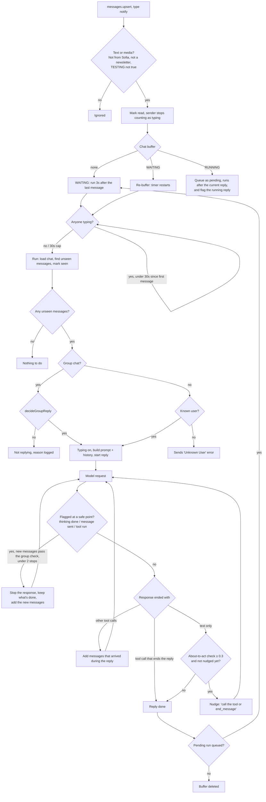

# How Sofia decides whether (and when) to reply
> [!NOTE]
> This document is generated by Claude Opus 5.5

The path a WhatsApp message takes from arriving to Sofia's reply, and every check on the way that can stop or delay it.

## 1. Which messages are considered (`botService.ts`, `messages.upsert`)

Only `notify` upserts are handled, and a message must:

- have text (`conversation` / `extendedTextMessage`) or media (image, sticker, video/GIF, poll),
- not be from Sofia's own account (`fromMe`) or a newsletter channel,
- arrive while `TESTING` is not `true`.

Sofia then subscribes to the chat's presence (to see typing), marks the message read, and clears the sender's typing
status (they just sent something).

## 2. Waiting for the chat to go quiet (`bufferSystem.ts`)

Each chat has at most one buffer:

| State when a message arrives | What happens |
|---|---|
| No buffer | Starts one in `WAITING`, runs 3s (`delayMs`) after the last message |
| `WAITING` | The 3s timer restarts from this message |
| `RUNNING` (Sofia is replying) | Stored as `pending`, runs once the current reply finishes. Only the latest is kept, which is fine because a run always loads every unseen message |

While anyone in the chat is typing, the run is pushed back. A participant counts as typing for 15s (`typingTimeoutMs`)
after their last `composing` update unless they stop earlier, and typing can delay a run by at most 30s (`maxWaitMs`)
after the first buffered message. Typing is tracked per participant, so in groups one person going idle doesn't resume
the buffer while someone else is still typing.

## 3. What Sofia hasn't seen yet (`unseenMessages`, `markSeen`)

When the buffer runs, the chat history is loaded and Sofia's last seen message for the chat is looked up. Unseen messages
are the ones from other people after it; they can sit between Sofia's own messages if they were sent while she was
replying, and `formatHistory` moves those after her reply with a note so they don't look answered. After a restart there
is no record, so the messages after Sofia's last message count as unseen (`known: false`). The newest message is then
marked seen. No unseen messages means no reply.

## 4. Group chats: should Sofia reply at all? (`replyDecision.ts`)

`decideGroupReply` looks at the last 40 messages. Unseen messages are split into blocks of consecutive messages from the
same sender (the latest 3 blocks; only the latest block after a restart), each judged with the 12 messages before it.

1. Any block @mentions Sofia → **reply** (`@mentioned`).
2. Any block says "sofia" → **reply** (`named`).
3. Otherwise each block goes to the decision model (`decision-model-preview`, in parallel), which answers `addressee`,
   `kind`, `continues_sofia_thread` and `sofia_can_help`. Sofia replies if **any** block calls for it:
   - **Meant for Sofia** if it quotes her message, `addressee=sofia` ≥ 0.5, or she spoke recently and
     `continues_sofia_thread` ≥ 0.7. Then she replies if `school_question + social_question + request + emotional` ≥ 0.5,
     with `acknowledgement` also counted only when it's clearly for her (quotes her, or `addressee=sofia` ≥ 0.8). A clear
     acknowledgement sets `short`, and she's told to answer with one short message or just a sticker.
   - **Meant for the whole group / nobody**: replies only if `school_question` ≥ 0.5 and `sofia_can_help` ≥ 0.6.
   - **Meant for another member**: no reply.
4. If the decision model fails, she replies only if a block quotes one of her messages.

The decision and its reason are logged as `Group reply decision`. Typing is shown only after she decides to reply.

## 5. Private chats

No reply decision: every unseen message gets a reply, as long as the sender is a known user (`getUserByJid`). Unknown
users get "Error: Unknown User. Please contact Azlan for access!".

## 6. During the reply (`ai.ts`, `processChatv3`)

Each model request streams; every blank line in the text is sent as a new WhatsApp message, and tool calls run as soon as
they finish streaming.

**Stopping for new messages.** A message that arrives while Sofia is replying flags the running reply
(`BufferSystem.takeNewMessages`). The flag is checked at points where stopping loses nothing: her thinking has finished,
a WhatsApp message has been sent, or a tool call has run (never halfway through writing one). If it's set and
`messagesDuringReply` returns messages, the response is aborted and the next one continues with:

- everything that finished (her thinking, which the reasoning summary carries in full, and tool calls with their results,
  so nothing that ran is run again),
- the text already sent, if it stopped mid-text, with a note that it was sent and she should continue without repeating
  it (the unsent rest is dropped),
- the new messages with the "arrived while you were replying" note.

A reply is stopped at most twice (`MAX_INTERRUPTS`). In group chats `messagesDuringReply` runs `decideGroupReply` on the
new messages first and returns nothing if Sofia wouldn't reply to them, so the response carries on.

When a request ends:

- **A tool ended the reply** (`end_message`, or a tool called with `end_message: true` like `send_sticker_gif`) → done.
- **There were other tool calls** → any messages that arrived during the reply and weren't added yet
  (`messagesDuringReply`, same group check) are added with a note and marked seen, then the next request runs.
- **Text only** → the about-to-act check (`unfinishedReply.ts`) scores whether the reply ends with Sofia saying she's about
  to do something. At ≥ 0.3, once per reply, she's nudged to call the tool or `end_message`, and another request runs.
  Otherwise the reply is done.

## 7. After the reply

If a message arrived while she was replying and wasn't already added mid-reply, the pending run starts the whole flow
again from step 2 (3s wait, typing, unseen messages, group decision). If everything was added mid-reply, it finds no
unseen messages and stops.

## Known gaps

- A reply ended by a tool (`end_message`, or a sticker with `end_message: true`) isn't stopped, so anything that arrived
  goes to the pending run and gets its own reply.
- After 2 stops, further messages go to the pending run.
- Stopping doesn't wait for the sender to finish typing, so a third message right after can cause another stop.
